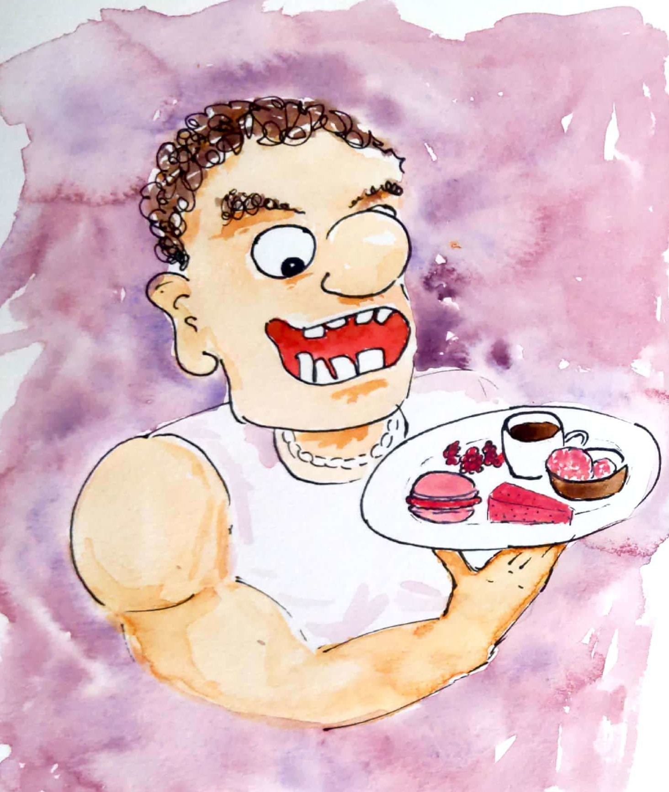
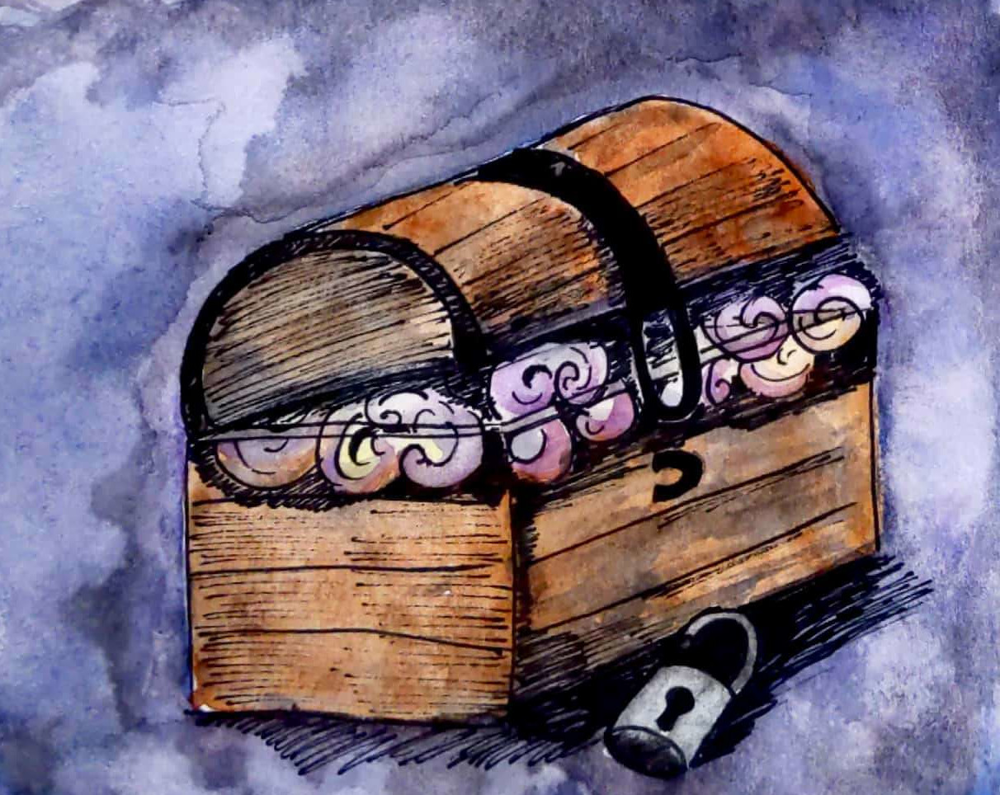
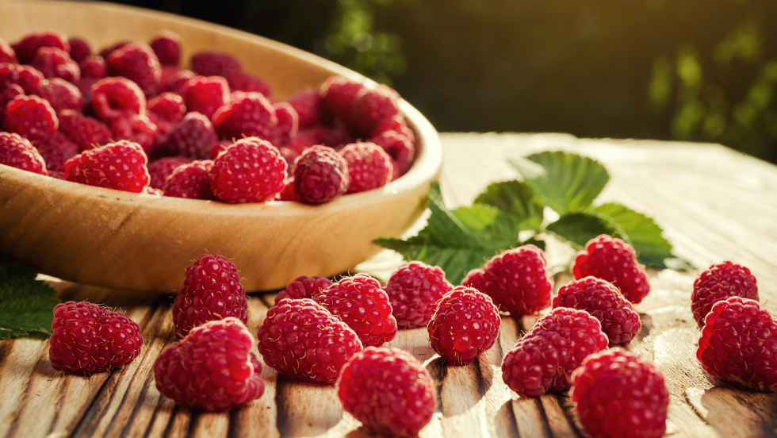

### Chapitre 31 Toulouse : Le buisson de framboises

Dans un jardin de doux plaisirs, la framboise est visible de loin. Rouge vive tel un saphir elle se cache derrière des feuilles. Seuls quelques rayons du soleil peuvent la toucher. Elle éveille mon cœur et dans ma bouche c'est une explosion de saveur comme dans le film ratatouille.

------------------------------------------------------------------------

title: "Histoire"

format: html

editor: visual

------------------------------------------------------------------------

### Chapitre 2 : Rencontre de l'ogre 2 le retour

Je (LN) me promenais dans la grande forêt des Grands-Framboisiers écarlates et rencontrai un immense et terrifiant ogre...

La grande forêt des Grands-Framboisiers écarlates était son magnifique paradis. L'ogre ressemblait à un pizzaiolo, avec un fond de gorge rose écarlate et tout frisé. Quand il avait sa bouche ouverte, on avait du mal à le discerner des Grands framboisiers. Ce qui lui permettait de manger des framboises sans être vu.

Mais aujourd'hui il avait beaucoupissime faim !

Il avait faim de saucisson brioché chaud et, justement, je sortais tout juste de son boucher du coeur où je venais d'acheter... du saucisson lyonnais bien chaud !

"berk,berk,berk" pensa-t-il, "c'est sur qu'elle l'a pris aux pistaches et non aux framboises.... et je suis allergique aux pistaches"! Mais heureusement, une belle framboise du nom de Barbi passait par là. Barbi qui avait le coeur framboise, réussit à remplacer les pistaches par des framboises. Tout heureux, l'ogre se concentra sur son assiette saucisson/framboise

### Chapitre 3 : L'ours insomniaque

Je sortis de ma poche un petit flacon de miel, que je donnai à l'ours insomniaque. "Merci infiniment ! C'est exactement ce dont j'avais besoin pour arriver à boire ma tisane à la camomille, sans miel c'est vraiment infect..." Me dit l'ours souriant.

### Chapitre 4 : Récupérer la clef

Cette action emplit l'ours de joie, qui, pour me faire part de sa reconnaissance, me donna la clef du coffre.

### Chapitre 5 : Le coffre au trésor

Dans le coffre nous croyons retrouver des objets assez surprenants. Nous avons vu jaillir une lumière qui nous a aveuglé. Malgré cet handicap visuel nous avons le coeur en fête. On se frotta les yeux pour mieux voir mais aussi pour revenir à la réalité . mais la réalité nous a percuté encore plus fort car la lumière n'était qu'un vieux phare qui s'allume dans l'obscurité. une fois le coffre sortie de la grotte ce phare ne servi plus à rien . 

Dans le coffre nous croyons retrouver des objets assez surprenants. Nous avons vu jaillir une lumière qui nous a aveuglé. Malgré cet handicap visuel nous avons le coeur en fête. On se frotta les yeux pour mieux voir mais aussi pour revenir à la réalité . mais la réalité nous a percuté encore plus fort car la lumière n'était qu'un vieux phare qui s'allume dans l'obscurité. une fois le coffre sortie de la grotte ce phare ne servi plus à rien .

### Chapitre 6.0 : Le salon du hobbit

L'ogre continuant son chemin, passa sans le savoir au-dessus d'une maison de hobbit. Son pied, traversa le plafond de ce dernier qui pensais que le ciel lui tombait sur la tête. Le pauvre bougre venais tout juste de terminer de préparer le diner lorsque son salon s'est éffondré ! - Non d'un poireau ! Mais que se passe t-il ?! Il y a un pied dans mon salon! - Sol pas solid ! - Hey vous ! Ne regardez-vous pas où vous mettez les pieds ! - FAAAAIIIM !

L'ogre s'empara de la marmite et englouti le repas du hobbit. Avant de repartir sur les chemins, laissant le hobbit dépourvu de salon ... et de diner !

### Chapitre 7 : L'ogre n'a plus faim, il a soif

Après ce bon repas, l'ogre n'avait plus faim du tout. Il se laissa tomber lourdement sur son immense fauteuil en bois, qui craqua sous son poids. Ses yeux, habituellement brillants de malice et de faim insatiable, étaient maintenant mi-clos, reflétant une satisfaction profonde. Il poussa un long soupir de contentement, faisant trembler les murs de sa caverne sombre et humide.

Autour de lui, les restes du festin jonchaient la table : des os rongés, des assiettes vides et des verres renversés témoignaient de l'appétit vorace de l'ogre. Il avait dévoré tout ce qui lui était tombé sous la main, sans laisser la moindre miette. Son ventre, désormais plein à craquer, semblait sur le point d'éclater.

L'ogre se mit à rire, un rire tonitruant qui résonna dans toute la caverne. Il se sentait invincible, comblé par ce repas copieux. Pour une fois, il n'avait plus cette sensation de vide qui le tourmentait constamment. Il pouvait enfin se reposer, sans être hanté par la faim.

Il ferma les grands yeux bleu, laissant ses pensées vagabonder, il rêve sandwich, il pense sandwich, il vie sandwich. Il se remémora les aventures qui l'avaient mené à ce festin. Les défis qu'il avait surmontés, les ennemis qu'il avait vaincus. Tout cela en valait la peine, car il se sentait maintenant apaisé, prêt à affronter de nouvelles aventures.

Mais pour l'instant, il savourait ce moment de tranquillité. Il s'endormit paisiblement, bercé par le doux ronronnement de son estomac satisfait. La caverne, habituellement bruyante et agitée, était plongée dans un silence apaisant. L'ogre, ce géant terrifiant, était enfin en paix avec lui-même.

Et ainsi, dans cette caverne isolée, l'ogre passa une nuit sans rêves, sans cauchemars, sans la moindre pensée pour la nourriture. Il se réveillerait le lendemain, prêt à conquérir le monde, mais pour l'instant, il savourait simplement le bonheur d'avoir le ventre plein.

### Chapitre 8 : Les chaussures de l'ogre

### Chapitre 9 : la Fée du lac

### Chapitre 10 : la Vraie Sorcière des Montagnes

Non loin de la caverne se situait un lac secret, où vivait une fée. La fée bleue. Fatiguée par les ronflements, elle alla voir l'orgre et lui jeta un sort ! Orgre il n'était plus.
Elle l'avait transformer en grenouille, croassante. Un chat, paresseusement endormi aux abords du lac, un brun de soleil venant éclairé son pelage brillant, il perçu la magie invoquée par la fée. Il s'approcha et pris conscience de la métamorphose de l'ogre. 

### Chapitre 15 : rêves secret, doux sommeil dans les bras de morphée

### Chapitre 19 : euh pourquoi il manque tant de chapitre ??

Alors chers lecteurs, il est temps de vous faire un résumé de cette belle histoire que vous avez évidemment lu avec grande attention !
C'est une histoire de à dormir debout qui mélange féérie, coffre, orgre et framboises !

Bon enfaite, cela n'a pas de sens c'est sans queue ni tête ! L'histoire commence avec la descripttion d'un buisson de framboises puis ça dégénéré en rencontres avec un ogre affamé puis un ours insomniaque ????
Mais où va le monde ???

Les chaussures de l'ogre ont disparu tel un tour de magie et ensuite on passe sur un fée du lac (comme dans la légnde du roi Arthur ???).

### Chapitre 16 : L'avènement du sultan Gengis

Gengis grandit dans une province des plus banales de la Turquie. Il savait lire l'alphabet à l'envers dès ses 45 ans. Au vu de sa capacité d'analyse reconnue par ses tiers il fut rapidement demandé au pouvoir, au nom de tout un peuple. 

Une prise de pouvoir difficile

Sa nouvelle fonction lui a permis l'accès aux encyclopédies nationales dont à présent seul lui à l'accès. Ce monopole sur le savoir national laisse entrevoir en lui une opportunité de manipulation. Il alla même jusqu'à inventer une langue sortie de nulle part dont lui seul connaît les rouages. Il la rend obligatoire dès le CP en lv2. Cette quête populaire de comprendre la fameuse langue du sultan ne fait pas l'unanimité. Très vite une révolution se mis en place, sa tête est mise à prix à l'octobre 67. 

Une fin radicale

Avec leurs couteaux et leur machettes, les révolutionnaires franchirent la garde royale sans crainte. Gengis fut prit d'assaut et joua la carte de la folie pour s'en tirer " Moi s'il épargnez plaît vous ". POV personne ne compris et il fut lynché puis écartelé en place publique. Ils lui ont même déchiré son durag. 

### Conclusion : Une lumière dans la framboise

Ainsi s’achève notre aventure, née d’un buisson de framboises et guidée par un ogre affamé, un ours insomniaque et un coffre plein d’illusions lumineuses. Peut-être n’y avait-il pas de trésor, mais chaque rencontre fut un éclat sucré, une histoire en soi. Et dans le fond, n’est-ce pas la plus précieuse des trouvailles ?
Moral de l'histoire : Ce n'est pas parce qu'un clé n'ouvre aucune porte qu'elle ne sert à rien.

sandwich sandwich
sandwich sandwich
sandwich sandwich
###Dessert
Papaye, mangue, orange, banane, goyave
sandwich sandwich

A noter que l'absence des chapitres 7 ainsi que 11 à 14 est un choix purement artistique et délibéré

### Epilogue
Un an après, Framboisette invite ses amis à déguster un délicieux sandwich.
Miam ! Bonne appétit!
FAAAAIIIM

Nous remercions Tom pour son travail journalistique remarquable.

Je remercie Roland, Olivier, Jeanne, Laura, Inès, Paul, Fanny, Lisa, Angélique, Silya, Charlotte, Etan, Tom, Stépahnie, Kolia, Nicolas, Paul pour leur telle gentiellesse qui dépasse celle qu'on peut imaginer. Un seul mot qui brille comme une vieille pièce de monnaie : Merci. Je ne vous souahaite que le meilleur. 

### Déconclusion 

Après toute cette histoire, vint un gros zombie poilu qui aimait lui aussi se gaver de framboises magiques.
Il trouvait que le jus de framboise se rapprochait du sang des humains sans avoir a en tuer. En effet, il était très gentil 
et n'aimait pas trop tuer des humains qui était de plus particulièrement utiles à la production dans notre société capitaliste(même si ils sont de plus en 
plus remplacés par l'IA). Bref, il aimait beaucoup les framboises et en mangeait beaucoup ce qui faisait qu'il était en très 
bonne santé. Un jour, il fut pris d'une fulgurance et tenta les mûres. C'était dégeulasse. Il reprit des framboises. C'était très bon. Miam miam les framboises.
Il était tellement en bonne santé qu'il décida de postuler en tant que cobaye dans un centre médical qui essayait de créer un sérum de longévité. 
Il fut très décu en apprenant le refus de sa candidature car "il était mort, c'est de la triche". Ainsi, il se dit que les humains n'étaient peut être pas si gentil 
que ça et que les framboises c'est quand même dégeulasse. Ainsi, il mangea le directeur du centre médical et comme c'était un médecin il avait le goût de doliprane ce qu'il aimait bien. 
Ce goût de doliprane calma son mal de tête constant qu'il avait depuis qu'il passait beaucoup de temps en soirée techno. 
Il se dit, "miam miam les humains c'est bon", mais la police n'était pas de cet avis. Elle vint l'arrêter et lui dire qu'il allait être 
enfermé dans un cercueil comme il était mort. 

Dans son cercueil, il eu le temps de beaucoup réfléchir à pas beaucoup de choses. Un jour il en eu marre et décida de donner un coup de point
qui cassa le cercueil qui n'était même pas enterré. C'était l'an 10 587, l'humanité avait disparu et la nature avait repris ses droits. 
Il pouvait de nouveau se gaver de framboises magiques et être ami avec des oiseaux. 
### Post-face
Que pensent les Mouflons de l'ENS des ogres et des framboises?

Salut, je suis assiette : je mange fourchette

Capitulo 1:

Este es un libro corto.

Fin.
